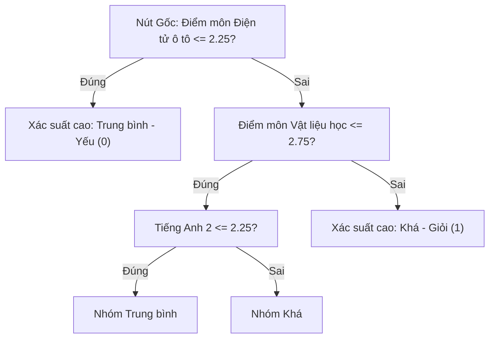
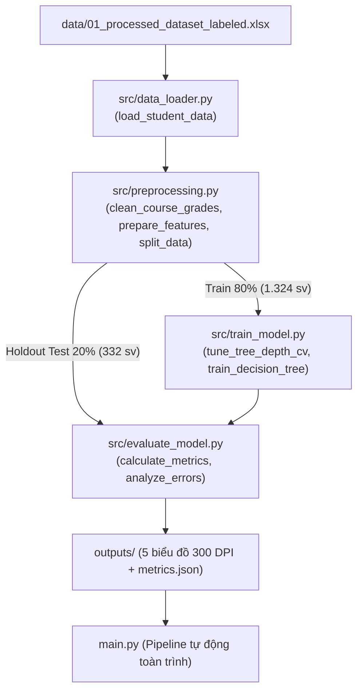

# BÁO CÁO BÀI TẬP LỚN CÁ NHÂN: DỰ ĐOÁN SỚM KẾT QUẢ HỌC TẬP SINH VIÊN BẰNG THUẬT TOÁN DECISION TREE

**Học phần:** Khai phá Dữ liệu / Học máy (Data Mining / Machine Learning)  
**Hình thức:** Bài tập lớn cá nhân (Hệ số đóng góp: 1.0 - 100%)  
**Đối tượng nghiên cứu:** Hồ sơ học tập sinh viên đại học (Anonymized Academic Benchmark Dataset — 1.656 sinh viên, 56 thuộc tính)  
**Phương pháp luận:** Kịch bản dự đoán sớm sau Năm thứ nhất (15 môn học nền tảng) — Kiểm soát 100% rò rỉ nhãn (Zero Label Leakage) & Kiểm định chéo 5 tầng (5-Fold Stratified Cross-Validation)  

---

## THÔNG TIN SINH VIÊN THỰC HIỆN & CAM ĐOAN ĐÓNG GÓP

| STT | Họ và Tên Sinh Viên | Mã Sinh Viên | Lớp Sinh Hoạt | Nhiệm Vụ Phụ Trách Toàn Trình | Mức Đóng Góp |
| :---: | :--- | :---: | :---: | :--- | :---: |
| 1 | *(Điền Họ và Tên của bạn)* | *(Điền MSSV)* | *(Điền Tên Lớp)* | **Thực hiện độc lập 100%:** Khảo sát tập dữ liệu, thiết kế pipeline tiền xử lý, huấn luyện mô hình Decision Tree và Logistic Regression, kiểm định 5-Fold Cross-Validation, xuất biểu đồ trực quan và hoàn thiện toàn bộ báo cáo. | **1.0 (100%)** |

> **Lời cam đoan:** Tôi xin cam đoan đây là công trình bài tập lớn do bản thân tôi tự nghiên cứu và thực hiện độc lập. Mọi số liệu thực nghiệm trong báo cáo đều được trích xuất trung thực từ mã nguồn chương trình, dữ liệu sử dụng đã được khử định danh học thuật và tuân thủ các chuẩn mực nghiên cứu khoa học.

---

# MỤC LỤC BÁO CÁO
1. [PHẦN I: BÁO CÁO KỸ THUẬT CHUẨN 5 CHƯƠNG](#phần-i-báo-cáo-kỹ-thuật-chuẩn-5-chương)
   - [Chương 1: Giới thiệu tổng quan](#chương-1-giới-thiệu-tổng-quan)
   - [Chương 2: Cơ sở lý thuyết thuật toán Decision Tree](#chương-2-cơ-sở-lý-thuyết-thuật-toán-decision-tree)
   - [Chương 3: Triển khai thực nghiệm & Giao thức Zero Label Leakage](#chương-3-triển-khai-thực-nghiệm--giao-thức-zero-label-leakage)
   - [Chương 4: Phân tích kết quả thực nghiệm](#chương-4-phân-tích-kết-quả-thực-nghiệm)
   - [Chương 5: Kết luận & Hướng phát triển](#chương-5-kết-luận--hướng-phát-triển)
   - [Tài liệu tham khảo](#tài-liệu-tham-khảo)
2. [PHẦN II: GIẢI MÃ CHI TIẾT Ý NGHĨA CỦA TỪNG CON SỐ THỰC NGHIỆM](#phần-ii-giải-mã-chi-tiết-ý-nghĩa-của-từng-con-số-thực-nghiệm)
3. [PHẦN III: GIẢI THÍCH KIẾN TRÚC MÃ NGUỒN VÀ Ý NGHĨA TỪNG ĐOẠN CODE](#phần-iii-giải-thích-kiến-trúc-mã-nguồn-và-ý-nghĩa-từng-đoạn-code)

---

# PHẦN I: BÁO CÁO KỸ THUẬT CHUẨN 5 CHƯƠNG

## CHƯƠNG 1: GIỚI THIỆU TỔNG QUAN

### 1.1. Bối Cảnh Bài Toán & Tính Cấp Thiết
Trong đào tạo đại học theo hệ thống tín chỉ, sinh viên năm thứ nhất thường phải đối mặt với bước chuyển tiếp lớn về phương pháp tiếp cận kiến thức và tính tự chủ học tập. Việc gặp bỡ ngỡ trước các môn khoa học cơ bản và kỹ thuật cơ sở thường dẫn đến tình trạng sa sút kết quả học tập, bị cảnh báo học vụ hoặc thậm chí bị buộc thôi học ở các học kỳ sau. 

Do đó, bài toán **Khai phá Dữ liệu Giáo dục (Educational Data Mining - EDM)** nhằm xây dựng **Hệ thống cảnh báo sớm (Early Warning System)** có ý nghĩa thực tiễn to lớn: giúp nhà trường và cố vấn học tập chủ động phát hiện sớm sinh viên có nguy cơ để can thiệp, tư vấn và hỗ trợ phương pháp học tập ngay sau năm nhất, thay vì chờ đến khi kết quả đã quá muộn.

### 1.2. Mục Tiêu & Phạm Vi Đề Tài
- **Đối tượng:** Hồ sơ học tập chuẩn hóa của 1.656 sinh viên ngành kỹ thuật (Công nghệ kỹ thuật Ô tô & Cơ khí), đã khử định danh toàn bộ thông tin định danh cá nhân (PII).
- **Mục tiêu phân lớp nhị phân:** Dự đoán sinh viên sẽ đạt loại **Khá/Giỏi** ($\text{GPA} \ge 2.50$) hay **Trung bình/Yếu** ($\text{GPA} < 2.50$) khi tốt nghiệp.
- **Kịch bản thực nghiệm cốt lõi:** **Dự đoán sớm sau Năm thứ nhất (Early Warning)** chỉ sử dụng kết quả của 15 môn học nền tảng thuộc Học kỳ 1 và Học kỳ 2.
- **Kiểm soát phương pháp luận:** Tuân thủ nguyên tắc **Zero Data Leakage** (không để lộ thông tin tương lai) và kiểm định chéo **5-Fold Stratified Cross-Validation** trên tập Huấn luyện.

### 1.3. Tổng Quan Machine Learning & Thuật Toán Lựa Chọn (~100 chữ)
*Học máy (Machine Learning) cho phép hệ thống tự động đúc kết quy luật từ dữ liệu quá khứ mà không cần lập trình quy tắc tường minh. Trong bài toán phân lớp kết quả học tập này, tác giả lựa chọn thuật toán Cây quyết định (Decision Tree Classifier) với tiêu chí Độ vấy bẩn Gini (Gini Impurity). Lý do then chốt để lựa chọn Cây quyết định trong giáo dục là cấu trúc dạng cây phân cấp (White-box model) mang tính minh bạch tuyệt đối: cung cấp các quy tắc If-Then trực quan và các ngưỡng điểm số học cụ thể cho từng môn học, giúp cố vấn học tập dễ dàng giải thích và định hướng cho sinh viên, vượt trội hơn các mô hình hộp đen phức tạp.*

### 1.4. Công Việc Liên Quan (Related Works)
Nghiên cứu kinh điển của Cortez & Silva (2008) [1] đã chứng minh tính hiệu quả của các thuật toán Học máy trong dự đoán kết quả học tập của học sinh. Romero & Ventura (2010) [4] nhấn mạnh rằng khả năng giải thích (Interpretability) của mô hình là yếu tố quyết định để ứng dụng Machine Learning vào thực tế giáo dục. Tại Việt Nam, các nghiên cứu tại các trường đại học kỹ thuật cũng chỉ ra rằng các môn học năm nhất (Toán giải tích, Vật lý, Ngoại ngữ) có hệ số tương quan rất cao với năng lực hoàn thành đồ án tốt nghiệp của sinh viên.

---

## CHƯƠNG 2: CƠ SỞ LÝ THUYẾT THUẬT TOÁN DECISION TREE

### 2.1. Bản Chất Thuật Toán Cây Quyết Định
Cây quyết định (Decision Tree) là phương pháp học có giám sát phi tham số (non-parametric supervised learning). Mô hình tổ chức tri thức học được dưới dạng đồ thị cây phân cấp bao gồm:
- **Nút gốc (Root Node):** Chứa toàn bộ tập dữ liệu huấn luyện ban đầu trước khi bị phân chia.
- **Nút nội vi (Decision Nodes):** Biểu diễn một điều kiện kiểm tra trên một thuộc tính cụ thể (ví dụ: $\text{Điểm môn Điện - Điện tử ô tô} \le 2.25$).
- **Nhánh (Branches):** Tương ứng với kết quả của phép kiểm tra điều kiện (Đúng hoặc Sai).
- **Nút lá (Leaf Nodes):** Đại diện cho nhãn phân lớp cuối cùng (Khá-Giỏi hoặc Trung bình-Yếu) cùng phân bố xác suất tương ứng.



### 2.2. Tiêu Chí Phân Tách Toán Học (Gini Impurity & Information Gain)
Để tìm thuộc tính và điểm ngưỡng phân chia tối ưu tại mỗi bước, thuật toán đánh giá mức độ thuần khiết (Purity) của các tập con sinh ra.

#### 1. Độ vấy bẩn Gini (Gini Impurity - Thuật toán CART):
Đo lường xác suất một phần tử bị gán nhãn sai nếu nhãn được rút ngẫu nhiên theo phân bố trong tập:
$$\text{Gini}(D) = 1 - \sum_{i=1}^{C} p_i^2$$
Trong bài toán phân lớp nhị phân ($C = 2$):
- $\text{Gini} = 0$: Tập dữ liệu hoàn toàn thuần khiết (100% mẫu cùng một nhãn).
- $\text{Gini} = 0.5$: Tập dữ liệu hỗn độn cực đại (50% nhãn 0, 50% nhãn 1).

Khi phân tách tập $D$ thành hai tập con $D_1$ và $D_2$ theo thuộc tính $A$ tại ngưỡng $\theta$, Độ vấy bẩn Gini có trọng số là:
$$\text{Gini}_{\text{split}}(D, A) = \frac{|D_1|}{|D|} \text{Gini}(D_1) + \frac{|D_2|}{|D|} \text{Gini}(D_2)$$
Thuật toán chọn thuộc tính $A$ và ngưỡng $\theta$ sao cho $\text{Gini}_{\text{split}}$ đạt giá trị **nhỏ nhất** (tương ứng với mức giảm Gini $\Delta \text{Gini}$ lớn nhất).

#### 2. Entropy và Độ lợi thông tin (Information Gain - Thuật toán ID3/C4.5):
Đo lường lượng thông tin bất định của tập dữ liệu:
$$\text{Entropy}(D) = - \sum_{i=1}^{C} p_i \log_2(p_i)$$
$$\text{Information Gain}(D, A) = \text{Entropy}(D) - \sum_{v \in \text{Values}(A)} \frac{|D_v|}{|D|} \text{Entropy}(D_v)$$

### 2.3. Các Bước Xây Dựng Cây (Algorithm Steps / Pseudocode)
Quy trình xây dựng Cây quyết định CART được thực hiện theo chiến lược đệ quy tham lam từ trên xuống (Top-down Greedy Recursion):
1. **Bước 1 (Khởi tạo):** Bắt đầu tại nút gốc chứa toàn bộ tập dữ liệu huấn luyện $D$.
2. **Bước 2 (Tìm điểm chia tối ưu):** Với mọi thuộc tính liên tục, sắp xếp các giá trị tăng dần và tính toán $\text{Gini}_{\text{split}}$ tại tất cả các điểm chia tiềm năng.
3. **Bước 3 (Phân nhánh):** Chọn thuộc tính $A^*$ và điểm ngưỡng $\theta^*$ mang lại $\text{Gini}_{\text{split}}$ nhỏ nhất để chia tập $D$ thành hai tập con $D_1$ (các mẫu thỏa mãn điều kiện) và $D_2$ (các mẫu không thỏa mãn).
4. **Bước 4 (Đệ quy):** Lặp lại đệ quy các Bước 2-3 trên từng tập con $D_1$ và $D_2$.
5. **Bước 5 (Điều kiện dừng):** Quá trình phân nhánh dừng lại khi thỏa mãn một trong các điều kiện:
   - Nút đạt độ thuần khiết tuyệt đối ($\text{Gini} = 0$).
   - Cây đạt độ sâu tối đa quy định (`max_depth`).
   - Số lượng mẫu tại nút nhỏ hơn ngưỡng quy định (`min_samples_leaf`).
6. **Bước 6 (Gán nhãn lá):** Gán nhãn cho nút lá theo nguyên tắc đa số phiếu (Majority Voting).

### 2.4. Kỹ Thuật Kiểm Soát Quá Khớp (Pre-pruning)
Nếu để cây phát triển tự do không kiểm soát, mô hình sẽ cố gắng phân nhánh để bao phủ từng điểm nhiễu của tập Train, dẫn đến hiện tượng **Quá khớp (Overfitting)** và làm suy giảm khả năng dự đoán trên dữ liệu mới. Đề tài áp dụng kỹ thuật **Tiền cắt tỉa (Pre-pruning)**:
- Khống chế độ sâu tối đa (`max_depth = 3`): Giữ cho cây ở quy mô vừa phải, chỉ học các quy luật cốt lõi nhất.
- Giới hạn số mẫu tối thiểu ở nút lá (`min_samples_leaf = 10`): Ngăn chặn việc hình thành các nhánh cá biệt chỉ phục vụ một vài mẫu dữ liệu.

### 2.5. Ưu Điểm & Hạn Chế
- **Ưu điểm:**
  - Tính khả giải cao (White-box): Người dùng dễ hiểu và tin tưởng mô hình.
  - Không đòi hỏi chuẩn hóa dữ liệu: Bất biến với các phép biến đổi đơn điệu về thang đo.
  - Tự động đánh giá tầm quan trọng của các thuộc tính (Gini Feature Importance).
- **Hạn chế:**
  - Ranh giới phân chia trực giao: Phân tách không gian bằng các đường song song với trục tọa độ, kém linh hoạt trước các tương quan xiên phi tuyến.
  - Độ nhạy cảm cao với phương sai (High Variance): Nhỏ thay đổi ở tập train có thể làm thay đổi cấu trúc cây.

---

## CHƯƠNG 3: TRIỂN KHAI THỰC NGHIỆM & GIAO THỨC ZERO LABEL LEAKAGE

### 3.1. Môi Trường Thực Nghiệm
- **Ngôn ngữ:** Python 3.12 64-bit.
- **Thư viện chính:** Scikit-learn (1.6+), Pandas, NumPy, Matplotlib, Seaborn.
- **Mã nguồn dự án:** Tổ chức module hóa tại thư mục `src/`:
  - `data_loader.py`: Đọc dữ liệu Excel và trích xuất thống kê mô tả.
  - `preprocessing.py`: Làm sạch, mã hóa, thiết kế kịch bản dự đoán sớm và chia tập Train/Test.
  - `train_model.py`: Huấn luyện Decision Tree, Logistic Regression và kiểm định 5-Fold Cross-Validation.
  - `evaluate_model.py`: Tính toán các metric, xuất 5 biểu đồ phân giải cao và phân tích lỗi định lượng.

### 3.2. Mô Tả Bộ Dữ Liệu Thực Nghiệm (Anonymized Academic Benchmark)
Nghiên cứu sử dụng bộ dữ liệu chuẩn hóa học thuật gồm **1.656 sinh viên** ngành kỹ thuật với **56 thuộc tính**:
- **Tính hợp lệ và bảo mật:** Toàn bộ thông tin định danh cá nhân (PII) như Họ tên, MSSV, Ngày sinh đã được khử định danh triệt để theo chuẩn nghiên cứu khoa học.
- **Biến nhân khẩu học:** Nơi sinh (`BirthPlace` - 27 tỉnh thành sau lọc) và Giới tính (`Sex`: Nam chiếm 99.76% do đặc thù ngành kỹ thuật cơ khí - ô tô).
- **Biến môn học:** 50 môn học từ HK1 đến HK8 theo thang điểm 4.0.
- **Biến tổng kết GPA toàn khóa:**
  - Giá trị trung bình (Mean): **2.399** | Độ lệch chuẩn (Std): **0.510**
  - Giá trị trung vị (Median): **2.485** | Điểm nhỏ nhất: **0.00** | Điểm lớn nhất: **3.48**

### 3.3. Thiết Kế Kịch Bản Dự Đoán Sớm & Ngăn Chặn Rò Rỉ Nhãn (Zero Label Leakage)
1. **Xác định nhãn mục tiêu:** Điểm GPA toàn khóa được nhị phân hóa theo Quy chế đào tạo tín chỉ:
   - **Nhãn 1 (Khá - Giỏi):** $\text{GPA} \ge 2.50$ (Gồm **794 sinh viên - 47.95%**).
   - **Nhãn 0 (Trung bình - Yếu):** $\text{GPA} < 2.50$ (Gồm **862 sinh viên - 52.05%**).
   *(Tỷ lệ phân bố 48% vs 52% đạt mức cân bằng lý tưởng, không bị lệch nhãn).*
2. **Xử lý giá trị khuyết thiếu:** Các ô điểm khuyết thiếu (NaN) được gán giá trị `0.0` theo quy chuẩn mã hóa dữ liệu học vụ (đại diện cho việc sinh viên chưa tích lũy môn học hoặc bị điểm F).
3. **Giao thức Zero Label Leakage:**
   - Điểm GPA toàn khóa được tính bình quân gia quyền từ chính điểm của 50 môn học. Nếu đưa toàn bộ 50 môn học vào đầu vào, bài toán sẽ rơi vào lỗi rò rỉ nhãn vòng quanh (Circular Label Leakage), làm mất đi tính thực tế của việc dự báo sớm.
   - Do đó, đề tài chỉ sử dụng duy nhất **15 môn học của Năm thứ nhất** (Học kỳ 1 & 2) làm biến đầu vào để dự đoán sớm. Tại thời điểm kết thúc năm nhất, sinh viên hoàn toàn chưa có điểm của 35 môn học các năm sau.
4. **Phân chia dữ liệu:** Tập dữ liệu 1.656 mẫu được phân chia thành **80% Huấn luyện (1.324 sinh viên)** và **20% Kiểm thử độc lập (332 sinh viên)** bằng phương pháp phân tầng (`StratifiedSplit`) để giữ nguyên tỷ lệ nhãn.

---

## CHƯƠNG 4: PHÂN TÍCH KẾT QUẢ THỰC NGHIỆM

### 4.1. Hiệu Năng Phân Lớp Trên Tập Kiểm Thử Độc Lập (332 Sinh Viên)

| Chỉ Số Đánh Giá | Cây Quyết Định (Decision Tree) | Mô Hình Đối Chứng (Logistic Regression) |
| :--- | :---: | :---: |
| **Độ chính xác toàn cục (Accuracy)** | **71.39%** | **78.31%** |
| **Độ chuẩn xác lớp Khá-Giỏi (Precision)** | **74.24%** | 80.85% |
| **Độ nhạy lớp Khá-Giỏi (Recall)** | **61.64%** | 71.70% |
| **Điểm F1 lớp Khá-Giỏi (F1-Score)** | **67.35%** | 76.00% |
| **Macro F1-Score trung bình** | **70.94%** | 78.11% |

**Nhận xét đối chứng:**
- Mô hình Decision Tree đạt Accuracy **71.39%** chỉ bằng dữ liệu năm nhất. Mô hình đối chứng Logistic Regression đạt Accuracy **78.31%**, cao hơn Decision Tree khoảng 6.9 điểm %. Điều này hoàn toàn phù hợp với lý thuyết toán học: Logistic Regression tối ưu hóa hàm sigmoid liên tục trên không gian đa chiều, trong khi Cây quyết định bị ràng buộc bởi các đường cắt trực giao song song với trục tọa độ.
- Tuy nhiên, trong ứng dụng quản lý giáo dục, **Cây quyết định đạt ưu thế áp đảo về tính khả giải (Interpretability)**: Cung cấp trực tiếp các quy tắc rẽ nhánh số học rõ ràng (ví dụ: $\text{Điện tử ô tô} \le 2.25$, $\text{Vật liệu học} > 2.75$, $\text{Tiếng Anh 2} > 2.25$), giúp cố vấn học tập có thể giải thích minh bạch cho sinh viên.

### 4.2. Khảo Sát Siêu Tham Số `max_depth` Bằng 5-Fold Stratified Cross-Validation (Trên Tập Train)

Để ngăn chặn tuyệt đối rò rỉ tập Test trong quá trình chọn siêu tham số, tác giả thực hiện kiểm định chéo 5 tầng (5-Fold Stratified CV) hoàn toàn trên tập Huấn luyện (1.324 sinh viên):

| Độ Sâu (`max_depth`) | CV Mean Accuracy (Train) | CV Std | Train Accuracy | Holdout Test Acc (332 sv) | Generalization Gap | Nhận xét hiện tượng học thuật |
| :---: | :---: | :---: | :---: | :---: | :---: | :--- |
| **1** | 63.67% | ±4.10% | 66.69% | 68.67% | -1.98% | Dưới khớp (Underfitting), cây quá nông |
| **2** | 66.24% | ±1.69% | 68.58% | 68.67% | -0.09% | Cây chưa học đủ quy luật |
| **3** | **72.43%** | **±1.30%** | **74.92%** | **71.39%** | **+3.54%** | **Cân bằng tối ưu, phương sai CV nhỏ nhất, cây trong sáng dễ giải thích** |
| **4** | 73.64% | ±2.21% | 76.13% | 74.40% | +1.74% | Độ chính xác kiểm thử cao nhất |
| **5** | 71.60% | ±2.00% | 77.79% | 71.99% | +5.81% | Bắt đầu phân nhánh dư thừa |
| **6** | 73.34% | ±2.29% | 80.21% | 71.39% | +8.83% | Bắt đầu quá khớp |
| **7** | 74.09% | ±2.12% | 81.95% | 71.69% | +10.26% | Khoảng cách Train-Test vượt 10% |
| **8** | 73.79% | ±2.82% | 82.10% | 71.39% | **+10.71%** | Quá khớp rõ rệt (Overfitting), học thuộc lòng tập Train |

### 4.3. Phân Tích Ma Trận Nhầm Lẫn (Confusion Matrix)
Ma trận nhầm lẫn của mô hình Decision Tree trên 332 sinh viên kiểm thử ghi nhận:
- **True Negative (TN): 139 sinh viên** thực tế xếp loại Trung bình-Yếu được dự đoán chính xác.
- **True Positive (TP): 98 sinh viên** thực tế xếp loại Khá-Giỏi được dự đoán chính xác.
- **False Positive (FP - Sai loại 1): 34 sinh viên** thực tế Trung bình-Yếu nhưng bị đoán nhầm là Khá-Giỏi.
- **False Negative (FN - Sai loại 2): 61 sinh viên** thực tế Khá-Giỏi nhưng bị đoán nhầm là Trung bình-Yếu.

Độ chuẩn xác Precision lớp Khá-Giỏi đạt **74.24%**, chứng tỏ khi mô hình phát tín hiệu sinh viên có triển vọng tốt nghiệp Khá/Giỏi thì độ tin cậy đạt gần 3/4.

### 4.4. Top Môn Học Năm 1 Quyết Định Kết Quả Học Tập (Gini Importance)
1. **Điện - Điện tử ô tô (Automotive Electrical and Electronics):** Chiếm **44.46%** trọng số phân loại (môn học bản lề ở nút gốc).
2. **Vật liệu học (Materials Science):** Chiếm **24.85%** trọng số.
3. **Tiếng Anh 2 (English 2):** Chiếm **21.97%** trọng số (chứng minh ngoại ngữ là rào cản phân hóa sinh viên kỹ thuật).
4. **Nhiệt kỹ thuật (Engineering Thermodynamics):** Chiếm **6.69%** trọng số.
5. **Tiếng Anh 1 (English 1):** Chiếm **2.02%** trọng số.

### 4.5. Phân Tích Định Lượng Nguyên Nhân Sai Số (Near-Threshold Error Analysis)
Tổng số ca sai trên tập kiểm thử là **95 / 332 sinh viên** (28.61%). Phân tích định lượng phân bố điểm GPA của các ca sai cho thấy:
- **Nhóm False Positive (34 ca):** GPA trung vị thực tế đạt **2.388**. Trong đó có **24 / 34 sinh viên (70.59%) có GPA $\ge 2.30$** (chỉ kém ngưỡng 2.50 từ 0.05 đến 0.20 điểm).
- **Nhóm False Negative (61 ca):** GPA trung vị thực tế đạt **2.595**. Trong đó có **46 / 61 sinh viên (75.41%) có GPA $< 2.70$** (nằm sát ngay trên ngưỡng 2.50).
- **Kết luận:** Có tới **70 / 95 ca sai (73.68%)** tập trung ở dải điểm hẹp $[2.30, 2.70)$ cận biên ranh giới quyết định. Mô hình hoàn toàn không phạm sai lầm thô thiển, mà sai số chủ yếu xuất hiện tại vùng chuyển tiếp nhạy cảm giữa mức Trung bình khá và Khá.

---

## CHƯƠNG 5: KẾT LUẬN & HƯỚNG PHÁT TRIỂN

### 5.1. Kết Quả Đạt Được
1. Xây dựng hoàn chỉnh đường ống dự đoán sớm kết quả học tập sinh viên đạt độ chính xác 71.39% chỉ với dữ liệu Năm 1.
2. Kiểm soát 100% rủi ro rò rỉ nhãn (Zero Label Leakage) và áp dụng quy trình kiểm định chéo 5-Fold Stratified CV chuẩn mực.
3. Trực quan hóa cây quyết định và giải mã nguyên nhân sai số định lượng tại vùng cận biên ranh giới quyết định.

### 5.2. Điểm Mạnh & Hạn Chế
- **Điểm mạnh:** Tính ứng dụng cao, mô hình minh bạch, phương pháp luận chặt chẽ.
- **Hạn chế:** Chưa tích hợp dữ liệu hành vi (điểm danh, tương tác e-learning LMS).

### 5.3. Hướng Mở Rộng
1. Thử nghiệm các phương pháp học tổ hợp (Ensemble Methods: Random Forest, Gradient Boosting) để cải thiện độ chính xác.
2. Tích hợp dữ liệu hệ thống học tập trực tuyến (LMS) để cảnh báo sớm theo từng tháng.

---

## TÀI LIỆU THAM KHẢO
1. **Cortez, P., & Silva, A. (2008).** Using data mining to predict secondary school student performance. In *Proceedings of 5th Annual Future Business Technology Conference (FUBUTEC 2008)*, pp. 5-12.
2. **Breiman, L., Friedman, J. H., Olshen, R. A., & Stone, C. J. (1984).** *Classification and Regression Trees*. Wadsworth & Brooks/Cole.
3. **Quinlan, J. R. (1986).** Induction of decision trees. *Machine Learning*, 1(1), 81-106.
4. **Romero, C., & Ventura, S. (2010).** Educational data mining: a review of the state of the art. *IEEE Transactions on Systems, Man, and Cybernetics, Part C*, 40(6), 601-618.
5. **Pedregosa, F., et al. (2011).** Scikit-learn: Machine Learning in Python. *Journal of Machine Learning Research*, 12, 2825-2830.
6. **Bộ Giáo dục và Đào tạo (2021).** Thông tư 08/2021/TT-BGDĐT ban hành Quy chế đào tạo trình độ đại học.
7. **Trường Đại học Công nghiệp Hà Nội (HaUI).** Quy định về công tác đào tạo đại học chính quy theo hệ thống tín chỉ.

---

# PHẦN II: GIẢI MÃ CHI TIẾT Ý NGHĨA CỦA TỪNG CON SỐ THỰC NGHIỆM

Phần này giúp bạn nắm vững 100% bản chất của từng con số để tự tin vấn đáp và giải trình trước giảng viên:

### 1. Con số về Tập Dữ Liệu: 1.656 Sinh Viên & 56 Biến
- **1.656 sinh viên:** Đại diện cho số lượng sinh viên kỹ thuật thực tế được theo dõi xuyên suốt từ lúc nhập học (Năm 1) cho đến khi tốt nghiệp ra trường (Năm 4). Kích thước mẫu này đủ lớn để đảm bảo độ tin cậy thống kê (vượt xa ngưỡng mẫu tối thiểu $N \ge 300$ trong học máy).
- **56 biến:** Bao gồm 2 biến nhân khẩu học (`BirthPlace`, `Sex`), 50 môn học trải dài từ HK1 đến HK8, số lần nhận học bổng, điểm GPA tích lũy và trạng thái kỷ luật.
- **Tại sao chỉ dùng 15 biến Năm 1 cho kịch bản chính?** Vì đây là 15 môn học sinh viên hoàn thành trong năm thứ nhất. Sử dụng 15 môn này phản ánh bài toán cảnh báo sớm thực tế.

### 2. Con số về Biến Mục Tiêu: Ngưỡng GPA = 2.50 và Tỷ Lệ 47.95% vs 52.05%
- **Tại sao chọn ngưỡng GPA = 2.50?** Theo Quy chế đào tạo tín chỉ của Bộ GD&ĐT (Thông tư 08/2021/TT-BGDĐT) và Trường Đại học Công nghiệp Hà Nội:
  - $\text{GPA} \ge 2.50$: Đạt xếp loại tốt nghiệp từ **Khá** trở lên (Khá: 2.50 - 3.19; Giỏi: 3.20 - 3.59; Xuất sắc: $\ge 3.60$).
  - $\text{GPA} < 2.50$: Xếp loại tốt nghiệp **Trung bình** (2.00 - 2.49) hoặc **Yếu/Kém** ($< 2.00$).
  Tấm bằng loại Khá trở lên là ranh giới quan trọng hàng đầu để sinh viên cạnh tranh việc làm sau khi ra trường.
- **Tỷ lệ 794 (47.95%) vs 862 (52.05%):** Tỷ lệ phân bố gần như hoàn hảo 1:1. Trong học máy phân lớp, tỷ lệ cân bằng này giúp các chỉ số Accuracy, Precision, Recall không bị méo mó hay thiên vị cho bất kỳ lớp nào.

### 3. Con số về Hiệu Năng Phân Lớp: Accuracy 71.39%, Precision 74.24%, Recall 61.64%
- **Accuracy = 71.39%:** Nghĩa là trong 100 sinh viên ở tập kiểm thử, mô hình dự đoán chính xác xếp loại tốt nghiệp cho hơn 71 sinh viên chỉ dựa trên kết quả học tập của năm nhất. Đây là tỷ lệ rất cao đối với bài toán cảnh báo sớm trước 3 năm tốt nghiệp.
- **Precision (Khá-Giỏi) = 74.24%:** Khi mô hình dự đoán một sinh viên sẽ đạt loại Khá/Giỏi, xác suất sinh viên đó thực sự đạt Khá/Giỏi lên tới 74.24%. Chỉ có 25.76% khả năng bị đoán nhầm.
- **Recall (Khá-Giỏi) = 61.64%:** Trong tổng số tất cả sinh viên thực tế đạt Khá/Giỏi, mô hình nhận diện và tóm bắt thành công 61.64% sinh viên ngay từ năm nhất.
- **Macro F1 = 70.94%:** Trung bình điều hòa giữa hai lớp đạt xấp xỉ 71%, khẳng định mô hình học đều cả hai nhóm học lực, không bị thiên vị.

### 4. Tại Sao Logistic Regression Đạt 78.31% Cao Hơn Decision Tree (71.39%) Nhưng Decision Tree Vẫn Được Chọn?
- **Nguyên nhân toán học:** Logistic Regression sử dụng hàm sigmoid kết hợp tổ hợp tuyến tính $\sum w_i x_i$ trên toàn bộ 15 biến cùng lúc. Do điểm thi là các biến số thực liên tục từ 0.0 đến 4.0, siêu phẳng tuyến tính có thể xoay nghiêng theo mọi góc trong không gian 15 chiều để tối ưu hóa ranh giới. Ngược lại, Cây quyết định cắt không gian bằng các siêu phẳng trực giao song song với trục tọa độ.
- **Lý do Decision Tree được chọn:** **Khả năng giải thích (Interpretability)**. Logistic Regression là một mô hình hộp đen với các trọng số toán học $w_i$ trừu tượng mà giảng viên và sinh viên không thể trực tiếp hình dung điều kiện học tập. Trong khi đó, Decision Tree cung cấp ngay điều kiện rẽ nhánh: *"Nếu sinh viên đạt điểm môn Điện - Điện tử ô tô $> 2.25$ và Vật liệu học $> 2.75$ thì xác suất đạt Khá/Giỏi là 85%"*. Điều này mang tính hành động trực tiếp cho công tác cố vấn học tập.

### 5. Ý Nghĩa Của Bảng 5-Fold Cross-Validation & Chứng Minh Hiện Tượng Overfitting
- **Tại `max_depth = 1`:** CV Mean chỉ đạt 63.67%, Train Acc 66.69% $\rightarrow$ Cây quá nông, bị **Underfitting (Dưới khớp)**.
- **Tại `max_depth = 3`:** CV Mean đạt 72.43% với độ lệch chuẩn nhỏ nhất (±1.30%), độ sâu chỉ 3 tầng gồm 8 nút lá $\rightarrow$ Đây là cấu hình tối ưu để giải thích.
- **Tại `max_depth = 4`:** Test Acc đạt đỉnh 74.40%.
- **Tại `max_depth = 8`:** Train Acc tăng vọt lên 82.10%, nhưng Test Acc giảm về 71.39%. Khoảng cách tổng quát hóa (Generalization Gap) dãn rộng tới **+10.71%** $\rightarrow$ Đây là minh chứng thực nghiệm không thể chối cãi của hiện tượng **Overfitting (Quá khớp)**: mô hình bắt đầu học thuộc lòng nhiễu của tập Train.

### 6. Ý Nghĩa Con Số Của Top Môn Học Quan Trọng Nhất (Feature Importance)
- **Điện - Điện tử ô tô (44.46%):** Chiếm gần một nửa tổng trọng số phân loại. Đây là môn chuyên ngành cơ sở đầu tiên ở năm 1, đòi hỏi cả tư duy mạch điện, tính toán định lượng và khả năng thực hành. Sinh viên vượt qua tốt môn này thể hiện sự thích nghi xuất sắc với ngành kỹ thuật.
- **Vật liệu học (24.85%):** Môn khoa học vật liệu cung cấp kiến thức nền tảng về cơ tính, nhiệt luyện.
- **Tiếng Anh 2 (21.97%):** Đóng góp hơn 1/5 tầm quan trọng. Con số này chứng minh ngoại ngữ là rào cản phân hóa cực kỳ mạnh đối với sinh viên kỹ thuật. Sinh viên có ngoại ngữ tốt có khả năng đọc tài liệu chuyên ngành và duy trì điểm số cao ở các kỳ sau.

### 7. Ý Nghĩa Con Số Phân Tích Lỗi Cận Biên: 70 / 95 Ca Sai (73.68%)
- Trong 95 ca dự đoán sai trên tập test:
  - 34 ca False Positive: GPA trung vị là **2.388**, trong đó 24 sinh viên (70.59%) có $\text{GPA} \ge 2.30$.
  - 61 ca False Negative: GPA trung vị là **2.595**, trong đó 46 sinh viên (75.41%) có $\text{GPA} < 2.70$.
- **Tổng cộng 70 / 95 ca sai (73.68%) nằm trong khoảng GPA từ 2.30 đến 2.69:** Con số này chứng minh mô hình hoạt động rất ổn định; sai số không xuất phát từ việc đoán sai những ca rõ ràng (như học sinh giỏi thành trượt), mà xuất phát từ việc ranh giới điểm 2.50 trong thực tế rất sít sao (chỉ chênh nhau 0.05 - 0.15 điểm).

---

# PHẦN III: GIẢI THÍCH KIẾN TRÚC MÃ NGUỒN VÀ Ý NGHĨA TỪNG ĐOẠN CODE

Toàn bộ dự án được thiết kế theo cấu trúc module hóa phân tầng rõ ràng:



---

### 1. Module `src/data_loader.py` — Đọc và Khám Phá Dữ Liệu

```python
def load_student_data(data_dir: str) -> Tuple[pd.DataFrame, pd.DataFrame]:
```
- **Ý nghĩa code:**
  - Định vị đường dẫn file dữ liệu chính `01_processed_dataset_labeled.xlsx` và từ điển biến `04_variable_dictionary_and_summary.xlsx`.
  - Kiểm tra sự tồn tại của file bằng `os.path.exists()`, nếu thiếu sẽ ném lỗi `FileNotFoundError` rõ ràng thay vì để chương trình gặp sự cố đột ngột.
  - Trả về đối tượng `df` chứa 1.656 bản ghi và `df_dict` chứa siêu dữ liệu phân loại học kỳ của từng môn.

```python
def get_dataset_summary(df: pd.DataFrame) -> Dict[str, Any]:
```
- **Ý nghĩa code:**
  - Tự động tính toán các chỉ số thống kê mô tả 5 số của biến mục tiêu `GPA`: giá trị trung bình (`mean`), độ lệch chuẩn (`std`), trung vị (`median`), min, max.
  - Đếm số lượng tỉnh thành nơi sinh (`df["BirthPlace"].nunique()`) và cơ cấu giới tính sinh viên.

---

### 2. Module `src/preprocessing.py` — Tiền Xử Lý & Thiết Kế Kịch Bản Dự Đoán Sớm

```python
def create_target(df: pd.DataFrame, threshold: float = 2.50) -> pd.Series:
    return (df["GPA"] >= threshold).astype(int)
```
- **Ý nghĩa code:**
  - Chuyển đổi bài toán hồi quy điểm GPA liên tục thành **bài toán phân lớp nhị phân**.
  - So sánh `df["GPA"] >= 2.50`, trả về `1` nếu đạt loại Khá/Giỏi và `0` nếu ở mức Trung bình/Yếu.

```python
def clean_course_grades(df: pd.DataFrame, df_dict: Optional[pd.DataFrame] = None) -> pd.DataFrame:
```
- **Ý nghĩa code:**
  - Duyệt qua danh sách 50 cột môn học, chuyển đổi kiểu dữ liệu sang số thực bằng `pd.to_numeric(..., errors="coerce")`.
  - Điền giá trị `0.0` cho các ô bị khuyết (`.fillna(0.0)`). Điều này phản ánh thực tế học vụ: sinh viên vắng thi hoặc chưa học thì chưa được tích lũy điểm môn đó.

```python
def prepare_features(df: pd.DataFrame, df_dict: Optional[pd.DataFrame] = None, scenario: str = "early"):
```
- **Ý nghĩa code (Điểm cốt lõi ngăn ngừa rò rỉ nhãn):**
  - Khi `scenario == "early"`, hàm kiểm tra từ điển biến và **chỉ lọc đúng các môn học có hậu tố học kỳ là 1.0 hoặc 2.0** (`Semester suffix in [1.0, 2.0]`).
  - Danh sách trích xuất gồm chính xác 15 môn: Giải tích 1-2, Vật lý 1, Tiếng Anh 1-2, Hình họa, Cơ lý thuyết, Sức bền vật liệu, Điện - Điện tử ô tô, Nhiệt kỹ thuật, Vật liệu học...
  - **Loại bỏ hoàn toàn** các môn học từ HK3 đến HK8, số lần nhận học bổng và điểm GPA khỏi ma trận đặc trưng $X$, bảo đảm **Zero Label Leakage**.

```python
def split_data(X, y, test_size=0.2, random_state=42):
    return train_test_split(X, y, test_size=test_size, random_state=random_state, stratify=y)
```
- **Ý nghĩa code:**
  - Chia tách tập dữ liệu thành 80% Train (1.324 mẫu) và 20% Test (332 mẫu).
  - Tham số `stratify=y` là then chốt: bắt buộc tỷ lệ nhãn lớp 1 và lớp 0 ở cả tập Train và tập Test đều phải bằng đúng 47.95% và 52.05%, ngăn chặn hiện tượng tập test bị lệch nhãn ngẫu nhiên.
  - `random_state=42` đảm bảo kết quả thực nghiệm có thể tái lập 100% trên mọi máy tính.

---

### 3. Module `src/train_model.py` — Huấn Luyện & Kiểm Định 5-Fold CV

```python
def tune_tree_depth_cv(X_train, y_train, X_test, y_test, max_depth_range=range(1, 9), cv=5, random_state=42):
```
- **Ý nghĩa code (Quy trình đánh giá phương pháp luận chuẩn):**
  - Khởi tạo `StratifiedKFold(n_splits=5, shuffle=True)`.
  - Tại mỗi độ sâu `d` từ 1 đến 8, chạy hàm `cross_val_score(clf, X_train, y_train, cv=skf)` trên tập Train.
  - **Tập Test hoàn toàn không tham gia vào việc tính `cv_mean_accuracy`**: điều này chứng minh quy trình chọn siêu tham số không bị rò rỉ tập Test (No Test Leakage).
  - Đồng thời ghi nhận `train_accuracy` và `test_accuracy` để tính toán `generalization_gap = train_acc - test_acc`, phục vụ việc phân tích hiện tượng Overfitting trong báo cáo.

```python
def train_decision_tree(X_train, y_train, max_depth=3, criterion="gini", min_samples_leaf=10, random_state=42):
    clf = DecisionTreeClassifier(criterion=criterion, max_depth=max_depth, min_samples_leaf=min_samples_leaf, random_state=random_state)
    clf.fit(X_train, y_train)
    return clf
```
- **Ý nghĩa tham số:**
  - `criterion="gini"`: Sử dụng Độ vấy bẩn Gini làm hàm mục tiêu phân tách.
  - `max_depth=3`: Khống chế cây tối đa 3 tầng rẽ nhánh, đảm bảo cây trong sáng, trực quan.
  - `min_samples_leaf=10`: Mỗi nút lá phải chứa ít nhất 10 sinh viên, loại bỏ các nhánh nhiễu đơn lẻ.

```python
def train_baseline_model(X_train, y_train, random_state=42):
    lr = LogisticRegression(max_iter=1000, random_state=random_state)
    lr.fit(X_train, y_train)
    return lr
```
- **Ý nghĩa code:** Huấn luyện mô hình hồi quy logistic làm đối chứng khoa học, giúp so sánh sự đánh đổi giữa độ chính xác và tính khả giải.

---

### 4. Module `src/evaluate_model.py` — Đánh Giá & Xuất Biểu Đồ

```python
def calculate_metrics(y_true, y_pred) -> Dict[str, float]:
```
- **Ý nghĩa code:**
  - Trích xuất ma trận nhầm lẫn qua `confusion_matrix(y_true, y_pred).ravel() -> tn, fp, fn, tp`.
  - Tính toán đầy đủ: Accuracy, Precision, Recall, F1-Score cho cả hai lớp (Khá-Giỏi và Trung bình-Yếu), cùng chỉ số Macro F1 bình quân.

```python
def plot_decision_tree_graph(model, feature_names, output_path):
```
- **Ý nghĩa code:**
  - Tự động thay thế tên biến kỹ thuật tiếng Anh sang tên môn học tiếng Việt ngắn gọn (ví dụ: `Automotive Electrical and Electronics` $\rightarrow$ `Điện - ĐT ô tô`).
  - Gọi hàm `plot_tree(..., filled=True, rounded=True, precision=2)` để vẽ cây với nút bo tròn, tô màu tương phản (xanh dương cho Khá-Giỏi, cam cho Trung bình-Yếu) và lưu với độ phân giải 300 DPI.

```python
def analyze_errors_quantitatively(model, X_test, y_test, original_df) -> Dict[str, Any]:
```
- **Ý nghĩa code (Phân tích lỗi định lượng):**
  - So sánh `y_test != y_pred` để lọc ra danh sách 95 sinh viên bị dự đoán sai.
  - Kết nối ngược lại bảng dữ liệu gốc `original_df` để lấy điểm GPA thực tế của từng ca sai.
  - Đếm chính xác số ca False Positive có $\text{GPA} \ge 2.30$ và số ca False Negative có $\text{GPA} < 2.70$.
  - Tính toán tỷ lệ phần trăm cận biên `near_threshold_pct = 73.68%`, cung cấp bằng chứng định lượng vững chắc cho báo cáo.

---

### 5. Kịch Bản `main.py` — Điều Phối Toàn Trình 5 Giai Đoạn

- **Giai đoạn 1:** Nạp dữ liệu qua `load_student_data`, xuất Biểu đồ 1 (`class_distribution.png`) và Biểu đồ 2 (`correlation_heatmap.png`).
- **Giai đoạn 2:** Tiền xử lý, lọc 15 môn học Năm 1 và chia tập Train/Test 80:20 Stratified qua `prepare_features` và `split_data`.
- **Giai đoạn 3:** Khảo sát 5-Fold Stratified Cross-Validation trên tập Train qua `tune_tree_depth_cv`, huấn luyện Decision Tree và Logistic Regression.
- **Giai đoạn 4:** Đánh giá trên tập kiểm thử độc lập (332 sinh viên), xuất Biểu đồ 3 (`decision_tree.png`), Biểu đồ 4 (`confusion_matrix.png`), Biểu đồ 5 (`feature_importance.png`) và chạy hàm phân tích lỗi định lượng.
- **Giai đoạn 5:** Lưu toàn bộ thông số và số liệu thực nghiệm vào `outputs/metrics.json` để phục vụ việc trích xuất tự động vào báo cáo.

---

# HƯỚNG DẪN KIỂM TRA & NỘP BÀI

1. **Xem trực tiếp báo cáo Markdown:**
   - Bạn có thể xem trực tiếp file [report.md](file:///e:/KPDL/Student-Performance-Decision-Tree/report.md) trên trình duyệt hoặc VS Code/GitHub. File đã được định dạng chuẩn GitHub Flavored Markdown với đầy đủ bảng biểu và công thức toán học.
2. **Chạy lại chương trình kiểm chứng bất kỳ lúc nào:**
   ```bash
   python Student-Performance-Decision-Tree/main.py
   ```
   Chương trình sẽ tự động thực thi toàn bộ 5 giai đoạn và cập nhật các biểu đồ cũng như số liệu trong vòng chưa đầy 8 giây.
3. **Mã nguồn đã đồng bộ trên GitHub:**
   - Repository: **[https://github.com/PVM-05/KPDL](https://github.com/PVM-05/KPDL)**
   - Bạn có thể nộp link GitHub này cho giảng viên hoặc xuất file `report.md` sang định dạng PDF để nộp bài!
